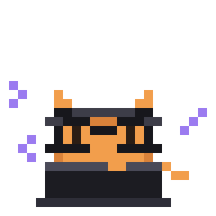

<p align="center">
  
</p>

<h1 align="center">Meowtify</h1>

<p align="center">
  A fast, lightweight music player written in Rust, with a pixel-art soul and plugin support.<br>
  Your own music library, YouTube search, endless autoplay, synced lyrics and listening parties.
</p>

<p align="center">
  
  
  
  
  <a href="https://slint.dev"></a>
</p>

---

## Why Meowtify

- **Light.** The whole app stays under 300 MB of RAM in normal use. That is a hard limit, and a
  change that breaks it is treated as a bug. Lists are virtual, covers come from a disk cache,
  and there is no embedded web browser.
- **Fast.** Native Rust with a lightweight renderer (Slint with FemtoVG), and optional
  streaming playback that starts while a song is still downloading.
- **Yours.** Your music is plain files in a folder you choose. The app keeps only a small index.
  There is no account to create.
- **Extensible.** Sandboxed WebAssembly plugins can extend the client without forking it.

## Features

| | |
|---|---|
| **Local library** | Point it at a folder. It scans recursively and reads tags. |
| **Search and play from YouTube** | Search, or paste a link, then click a song to play it. It downloads in the background through `yt-dlp` and joins your library. |
| **Autoplay** | When the queue ends, it keeps going with songs close to the current one. It learns from what you skip and finish, on your machine only. |
| **Queue** | Songs you add come first. Autoplay songs follow. Shuffle and three repeat modes. |
| **Synced lyrics** | Time-synced lyrics from [LRCLIB](https://lrclib.net) that glide line by line, or your own `.lrc` file next to a song. |
| **Jam sessions** | Listen together. One person hosts, friends join by link, and the host's songs follow everyone. [Details below](#jam-sessions). |
| **Discord presence** | Shows what you are listening to, with a progress bar and the cover. |
| **Proxy support** | One setting routes every network call through your proxy. |
| **Pixel style** | A bundled Unifont-based font, an animated mascot and a chunky orange look. |

## Requirements

Meowtify is developed and tested on **Windows 10 and 11**. Other platforms have not been tried.

To run it you need nothing extra. It uses the `curl` that ships with Windows, and it keeps its
own copy of `yt-dlp` up to date. [`ffmpeg`](https://ffmpeg.org) is optional: with it, downloads
are tagged and converted when needed.

## Build from source

You need:

1. **Rust**, recent stable (installed with [rustup](https://rustup.rs)). Tested with 1.97.
2. **Visual Studio Build Tools** with the "Desktop development with C++" workload, which gives
   Rust its Windows SDK libraries and the resource compiler.
3. **Git**.

Then:

```
git clone https://github.com/jun-ro/meowtify
cd meowtify
cargo build --release
```

The app is `target\release\meowtify.exe`. A clean build takes a few minutes. It is one
self-contained file of about 50 MB, most of it the embedded font.

### First run

1. Open Settings and choose your music folder.
2. Search for a song, or paste a YouTube link, and click it.
3. Press `/` to jump to the search box.

Settings are stored in `%APPDATA%\Meowtify\config.json`.

### Tests

```
cargo test                  # the app
cargo test --workspace      # everything, including the plugin host
```

## Jam sessions

A jam needs a relay: a small server that introduces the host and the guests to each other. It
carries no music. You can run your own with
[**meowtify-relay**](https://github.com/jun-ro/meowtify-relay), which is one binary with no
setup.

1. Open the **Jam** page and paste your relay address, such as `wss://jam.example.com`.
2. Press **Start a jam** and share the link it gives you.
3. Guests open the link, or paste it on the Jam page, and press Enter.

By default your IP address is hidden from the other people in the jam, and audio goes through
the relay's TURN server. The **Privacy** switch on the Jam page lets you connect directly
instead. The person running the relay can always see who connects to it.

## Plugins

Plugins are WebAssembly components that run in a sandbox, so a plugin cannot reach anything the
host does not hand it. The interface is described in
[`crates/meowtify-plugin/wit`](crates/meowtify-plugin/wit).

## Project layout

| Crate | What it does |
|---|---|
| `meowtify` | The executable. |
| `meowtify-ui`, `meowtify-ui-view` | The controller and the [Slint](https://slint.dev) view. |
| `meowtify-core` | Shared types, the playback actor and the traits the others implement. |
| `meowtify-library` | Settings, the folder scan and the song index. |
| `meowtify-player` | Local audio playback (rodio and Symphonia). |
| `meowtify-provider` | Music providers and the download queue, running `yt-dlp`. |
| `meowtify-autoplay` | Finds songs close to the current one and queues them. |
| `meowtify-cache` | A small disk cache. |
| `meowtify-discord` | Discord Rich Presence over the local pipe. |
| `meowtify-jam-net` | The jam client: relay connection and direct WebRTC links. |
| `meowtify-plugin`, `meowtify-plugin-compile`, `meowtify-plugin-tests` | The WebAssembly plugin host, its install-time compiler and its tests. |

The jam wire format lives in the [relay repository](https://github.com/jun-ro/meowtify-relay),
so the client and the server cannot drift apart. To work on both at once, clone them side by
side and add this to `.cargo/config.toml`:

```toml
[patch."https://github.com/jun-ro/meowtify-relay"]
meowtify-jam = { path = "../meowtify-relay/crates/meowtify-jam" }
meowtify-jam-relay = { path = "../meowtify-relay/crates/meowtify-jam-relay" }
```

## A note on downloading

Downloading from YouTube can conflict with YouTube's Terms of Service, and copyright applies to
the files you download. Meowtify is a personal-use tool and is not approved by or affiliated
with any provider. You are responsible for how you use it.

## Credits and licenses

Meowtify is released under the [MIT License](LICENSE).

- The interface is built with [Slint](https://slint.dev), used under its Royalty-Free License.
- The UI font is derived from [GNU Unifont](https://unifoundry.com/unifont/), which is dual
  licensed under the SIL Open Font License 1.1 and the GNU GPL version 2 or later with the GNU
  Font Embedding Exception.
- Lyrics come from [LRCLIB](https://lrclib.net). Downloads use [yt-dlp](https://github.com/yt-dlp/yt-dlp).
